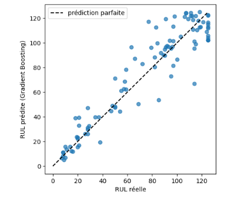
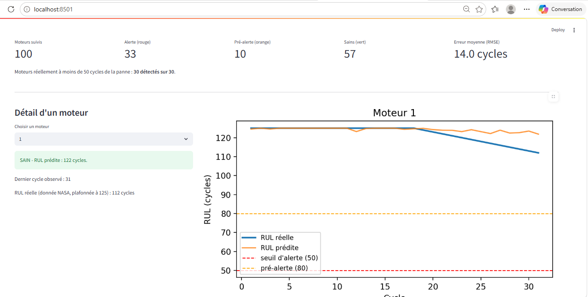
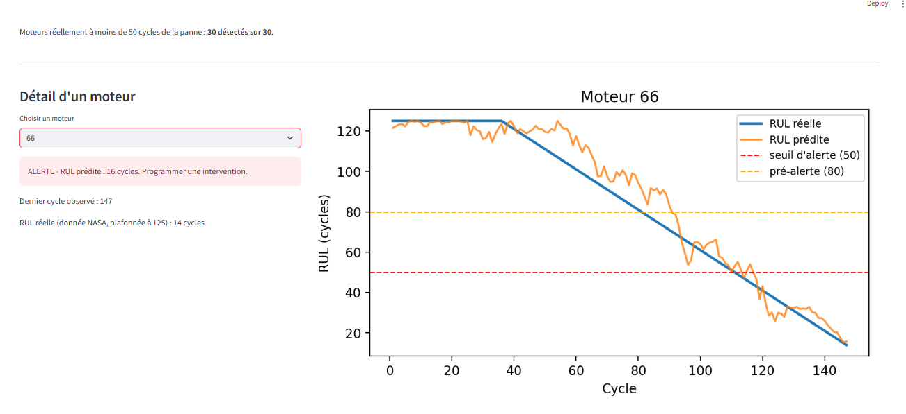

# Maintenance prédictive de moteurs d'avion (NASA C-MAPSS)

Projet personnel : prédire combien de cycles il reste avant la panne d'un moteur d'avion (durée de vie restante, ou **RUL** pour *Remaining Useful Life*), puis transformer cette prédiction en **règle d'alerte** de maintenance, avec un **tableau de bord** Streamlit.

> **Données simulées.** Le jeu de données NASA C-MAPSS est une simulation de laboratoire, pas une mesure sur de vrais moteurs. Ce projet illustre une méthode ; il ne prétend pas être prêt pour un usage industriel (voir *Limites*).



## Problème

Une maintenance **corrective** (on attend la panne) provoque des arrêts imprévus. Une maintenance **préventive à date fixe** remplace parfois trop tôt une pièce encore bonne, et parfois trop tard. L'approche **prédictive** vise à intervenir au bon moment pour chaque moteur, selon son état réel.

## Données

- Jeu de données **NASA C-MAPSS** (*Turbofan Engine Degradation Simulation*), sous-ensemble **FD001** : une condition de vol, un type de panne.
- 100 moteurs d'entraînement (suivis jusqu'à la panne) et 100 moteurs de test (arrêtés avant la panne, avec la vraie RUL fournie à part).
- Chaque ligne : un moteur à un cycle donné, avec 3 réglages et 21 capteurs.
- Durée de vie des moteurs d'entraînement : de 128 à 362 cycles (moyenne : 206).
- Les fichiers de données ne sont **pas inclus** dans ce dépôt. Ils sont à télécharger depuis le dépôt de données de pronostic de la NASA ou depuis Kaggle (vérifier la licence), puis à placer à côté du notebook : `train_FD001.txt`, `test_FD001.txt`, `RUL_FD001.txt`.
- Référence : A. Saxena, K. Goebel, D. Simon, N. Eklund, *Damage Propagation Modeling for Aircraft Engine Run-to-Failure Simulation*, PHM 2008.

## Méthode

1. **Calcul de la RUL** pour les moteurs d'entraînement : dernier cycle du moteur moins cycle courant.
2. **Nettoyage** : suppression des 7 colonnes constantes (`reglage_3`, `capteur_1`, `5`, `10`, `16`, `18`, `19`), puis des variables peu informatives. 14 capteurs conservés, choisis selon leur corrélation avec la RUL.
3. **RUL plafonnée à 125 cycles** : quand le moteur est neuf, les capteurs sont plats et ne permettent pas de distinguer 250 cycles restants de 200.
4. **Lissage** de chaque capteur par moyenne glissante sur 10 cycles, moteur par moteur.
5. **Variables de tendance** : variation de chaque capteur lissé sur 10 cycles, plus l'âge du moteur (numéro de cycle). C'est l'amélioration la plus importante du projet.
6. **Modèles comparés** : régression linéaire (référence), Random Forest, Gradient Boosting.
7. **Séparation toujours par moteur** (jamais par ligne), pour éviter qu'un même moteur apparaisse à la fois dans l'entraînement et dans le test.
8. **Règle d'alerte** : alerte si la RUL prédite passe sous un seuil ; choix du seuil par un raisonnement sur le coût des alertes manquées et des fausses alertes.

## Résultats

Erreur = RMSE en cycles, calculée sur la **RUL plafonnée à 125 cycles**. Elle n'est pas directement comparable aux chiffres publiés dans les articles sur C-MAPSS.

**Validation croisée (5 groupes de moteurs, tous cycles confondus)**

| Modèle | Erreur moyenne | Dispersion |
|---|---|---|
| Régression linéaire | 17,7 | ± 0,5 |
| Random Forest | 14,6 | ± 0,9 |
| Gradient Boosting | **14,3** | ± 0,8 |

**Test sur les 100 moteurs de test (dernier cycle connu de chaque moteur)**

| Modèle | Variables | Erreur |
|---|---|---|
| Régression linéaire | capteurs lissés | 22,0 |
| Random Forest | capteurs lissés | 20,7 |
| Gradient Boosting | capteurs lissés | 20,3 |
| Random Forest | + tendances + âge | 14,8 |
| Gradient Boosting | + tendances + âge | **14,0** |

Les modèles à arbres sont nettement meilleurs que la régression linéaire. L'écart entre Random Forest et Gradient Boosting est faible : le Gradient Boosting a été retenu parce qu'il est légèrement devant dans les cinq groupes de la validation croisée.

**Choix du seuil d'alerte (100 moteurs de test)**

| Seuil (cycles) | Détectés | Manqués | Fausses alertes |
|---|---|---|---|
| 20 | 11 | 2 | 3 |
| 30 | 19 | 6 | 1 |
| 40 | 27 | 1 | 0 |
| 50 | 30 | 0 | 3 |

Seuil retenu : **50 cycles**. Une alerte manquée (panne en service) coûte plus cher qu'une fausse alerte (intervention un peu trop tôt), et 50 cycles laissent le temps de commander les pièces. Avec ce seuil, les 30 moteurs réellement critiques sont détectés, avec 3 fausses alertes. Si les deux types d'erreur coûtaient autant, le seuil de 40 serait préférable : le choix dépend donc du rapport de coût, qui est ici une hypothèse.

## Tableau de bord




Le tableau de bord (`app.py`) affiche, pour les 100 moteurs de test : le nombre de moteurs par état (vert, orange, rouge), l'erreur moyenne, la courbe de RUL prédite contre RUL réelle d'un moteur choisi, et un tableau trié du plus urgent au moins urgent. Le seuil rouge est de 50 cycles ; le seuil orange (80 cycles) est indicatif.

## Lancer le projet

```bash
pip install -r requirements.txt
jupyter notebook maintenance_predictive.ipynb   # entraînement et évaluation, génère predictions_test.csv
streamlit run app.py                            # tableau de bord
```

## Limites

- **Données simulées** et propres, avec une définition claire de la panne. Sur de vrais équipements, il faut d'abord définir la panne et disposer d'historiques longs et fiables.
- **Seuil et modèle choisis avec les mêmes 100 moteurs de test** qui servent à mesurer les résultats : les performances annoncées sont légèrement optimistes. Une validation sur de nouveaux moteurs serait nécessaire.
- **Validation croisée et test ne mesurent pas la même chose** (tous les cycles contre le dernier cycle) : leurs chiffres ne sont pas interchangeables.
- RUL plafonnée à 125 cycles ; une seule condition de vol (FD001).
- Le rapport de coût entre alerte manquée et fausse alerte n'est pas une donnée mesurée.

## Pistes d'amélioration

- Sous-ensembles FD002 à FD004 (plusieurs conditions de vol et types de panne), avec normalisation des capteurs par condition de vol.
- Modèle de séquences (LSTM ou CNN 1D), à comparer honnêtement au Gradient Boosting.
- Intervalle d'incertitude autour de la RUL prédite, pour déclencher l'alerte avec plus de prudence.
- Évaluation avec la métrique asymétrique de la NASA.

## Outils

Python, pandas, NumPy, scikit-learn, matplotlib, Streamlit, Jupyter.

## Auteure

Zaineb Laroussi, ingénieure en génie électrique (ENIS Sfax) : [LinkedIn](https://linkedin.com/in/laroussi-zaineb)
